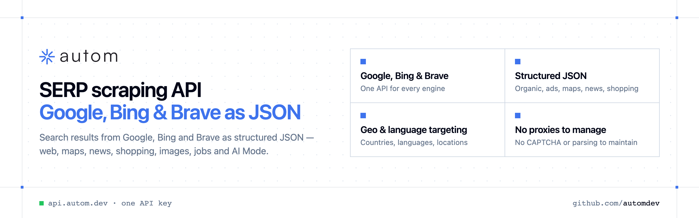

<p align="center">
  <a href="https://www.autom.dev"></a>
</p>

<p align="center">

[](https://discord.gg/CFj3ph8aHU) [](https://www.autom.dev) [](https://app.autom.dev/register) [](https://docs.autom.dev)

</p>

**Autom** is a SERP API: send a query, get **structured JSON** search results from Google, Bing and Brave. Each repository below documents one search product with copy-paste examples.

### Why Autom?

- **Every SERP in one API** — Google Search, AI Mode, Maps, News, Shopping, Images, Videos, Jobs, Autocomplete, plus Bing and Brave.
- **Structured JSON** — documented fields instead of brittle HTML parsing.
- **Geo & language targeting** — search like a user from the country and language you need.
- **One API key, one header** — `x-api-key` on every request.
- **Copy-paste examples** — Python and TypeScript in each README, 7 more languages in `examples/`.

```bash
curl -G https://api.autom.dev/v1/google/search \
  -H "x-api-key: $AUTOM_API_KEY" \
  --data-urlencode "query=web scraping api"
```

### Official SDKs

Use Autom from your own language with a typed client:

| SDK | Package | Install |
| --- | --- | --- |
| Node.js | [`@automdev/sdk`](https://www.npmjs.com/package/@automdev/sdk) | `npm install @automdev/sdk` |
| Python | [`automdev`](https://pypi.org/project/automdev/) | `pip install automdev` |
| Go | [`autom-go`](https://pkg.go.dev/github.com/automdev/autom-go) | `go get github.com/automdev/autom-go` |
| .NET | [`Autom`](https://www.nuget.org/packages/Autom) | `dotnet add package Autom` |
| Ruby | [`autom`](https://rubygems.org/gems/autom) | `gem install autom` |
| PHP | [`autom/sdk`](https://packagist.org/packages/autom/sdk) | `composer require autom/sdk` |
| Java | [`autom-java`](https://github.com/automdev/autom-java) | build from source, see its README |
| CLI | [`@automdev/cli`](https://www.npmjs.com/package/@automdev/cli) | `npm install -g @automdev/cli` |
| MCP server | [`@automdev/mcp`](https://www.npmjs.com/package/@automdev/mcp) | `npx -y @automdev/mcp` |

### Repositories

- [**Bing Search API**](https://github.com/automdev/bing-search-api) — Bing search results as structured JSON
- [**Brave Search API**](https://github.com/automdev/brave-search-api) — Brave web, image & video results as JSON
- [**DuckDuckGo Search API**](https://github.com/automdev/duckduckgo-search-api) — DuckDuckGo search results as structured JSON
- [**Google AI Mode API**](https://github.com/automdev/google-ai-mode-api) — Google AI Mode answers and sources as JSON
- [**Google Autocomplete API**](https://github.com/automdev/google-autocomplete-api) — Google search suggestions as JSON
- [**Google Images API**](https://github.com/automdev/google-images-api) — Google Images results as structured JSON
- [**Google Jobs API**](https://github.com/automdev/google-jobs-api) — Google for Jobs listings as structured JSON
- [**Google Maps API**](https://github.com/automdev/google-maps-api) — Google Maps places, ratings & contacts as JSON
- [**Google News API**](https://github.com/automdev/google-news-api) — Google News articles as structured JSON
- [**Google Search API**](https://github.com/automdev/google-search-api) — Google search results as structured JSON
- [**Google Shopping API**](https://github.com/automdev/google-shopping-api) — Google Shopping products & prices as JSON
- [**Google Videos API**](https://github.com/automdev/google-videos-api) — Google video results as structured JSON
- [**Web Search API**](https://github.com/automdev/web-search-api) — One call, several search engines, first organic results
- [**Yahoo Search API**](https://github.com/automdev/yahoo-search-api) — Yahoo search results as structured JSON

---

💬 [Discord](https://discord.gg/CFj3ph8aHU) · 📚 [API reference](https://docs.autom.dev) · 🔑 [Get your API key](https://app.autom.dev/register) · 🌐 [www.autom.dev](https://www.autom.dev)
